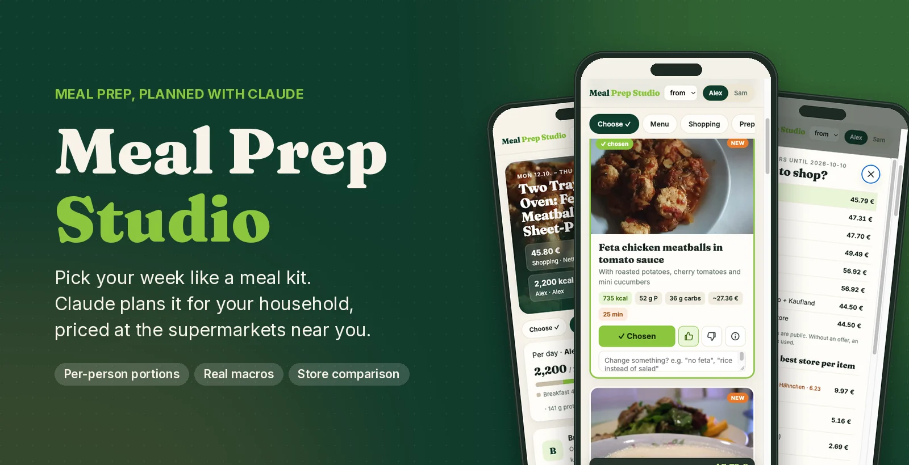
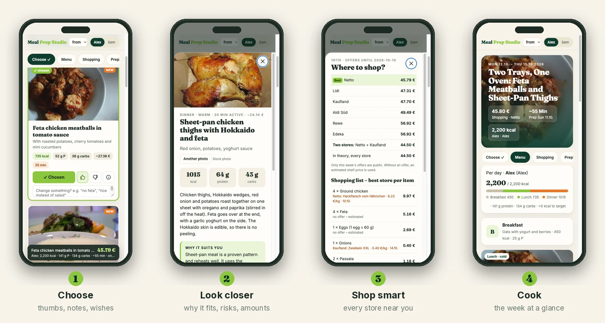
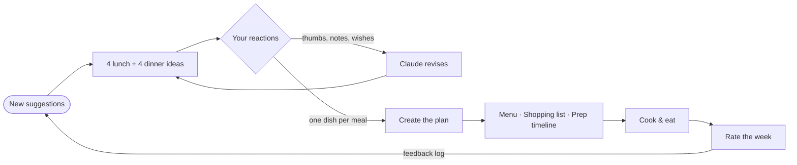
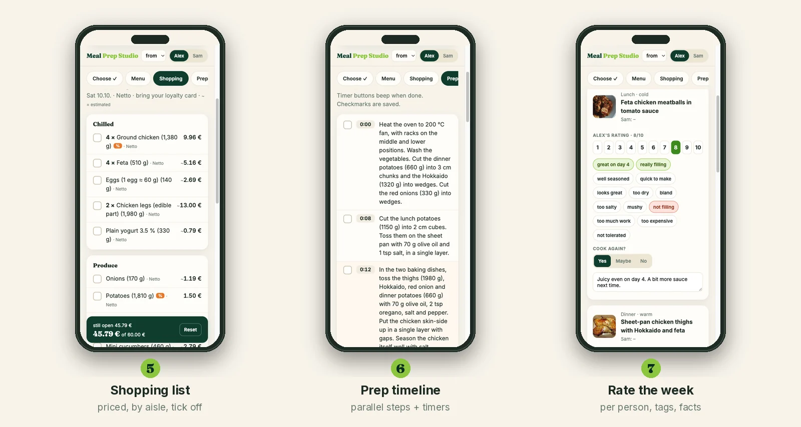

<div align="center">




<br>

**Your own meal-kit service, for the food you cook at home.**<br>
Claude suggests dishes and you pick them on your phone. You get the recipes, a shopping list priced
at the supermarkets near you, and a prep-day timeline.

<br>

[](#requirements)
[](#requirements)
[](https://claude.com/claude-code)
[](#configuration)
[](LICENSE)

[Quick start](#quick-start) · [How it works](#how-it-works) · [Configuration](#configuration) · [Privacy](#privacy-and-safety) · [FAQ](#faq)

</div>

---

## Why

Meal-prep plans usually fail for three reasons. Nobody likes the food, cooking takes all Sunday,
and the shopping costs more than planned. Meal kits get the experience right: you choose from a
few nice-looking dishes and everything arrives sorted. They're also expensive.

**Meal Prep Studio gives you that experience with your own supermarket and your own taste:**

- **You choose, Claude plans.** 4 lunch and 4 dinner ideas per round, each with a photo, macros,
  price and active cooking time. Give a thumbs up or down, add a note like "no feta" or "cheaper",
  and Claude revises the round in about 30 seconds.
- **The numbers are calculated.** Claude writes the recipes. Macros, portion splits, pack sizes
  and prices are calculated in Python from an ingredient database.
- **It learns your household.** Rate each week per person. Failures block a whole *category*,
  not just one recipe, and successes become rules for the next round.

## How it works





Each button starts one background job. The page shows its progress (loading offers, Claude
thinking, calculating, comparing stores, finding photos) and refreshes itself when the job ends.
You can close the page in between.

### After you choose



The **Daily** tab lists everything outside the prep block, day by day with checkboxes: putting the
meat away after shopping, preheating the dishes before you start, picking lettuce for the next two
days on Tuesday evening, and the one-minute assembly every morning and evening. The current day is
highlighted.

## Features

<table>
<tr>
<td width="50%" valign="top">

**Per-person portions**<br>
Two people with different calorie targets share one cooking session. The main part of each dish is
scaled so everybody hits their target, and the app tells you how many grams go into each box.

**Supermarket comparison**<br>
For Germany and Austria it compares Aldi, Lidl, Netto, Penny, Norma, Kaufland, Rewe, Edeka and
others for your postcode. You get one recommended store, or two if the second one saves enough.

**A prep timeline with timers**<br>
One combined schedule for every dish, with oven steps in parallel and amounts written into each
step. Tap a step to start its timer.

</td>
<td width="50%" valign="top">

**Hard exclusions**<br>
Allergies and intolerances are a filter, not just a hint. A dish that mentions an excluded
ingredient in its title or ingredient list is dropped. "Without X" is still allowed.

**Feedback that sticks**<br>
Each person scores each dish from 1 to 10 and can tap quick tags (*too dry, not filling,
great on day 4*). Claude turns this into ratings, blocked categories and rules in a Markdown log.

**Plain files, no lock-in**<br>
Profile, log, rounds and plans are Markdown and JSON in one folder you own. Each plan also comes
as a printable Markdown file.

</td>
</tr>
</table>

## Quick start

```bash
git clone https://github.com/fHpro0/mealprep-studio.git
cd mealprep-studio

./mealprep init ~/my-kitchen --lang en     # or --lang de
$EDITOR ~/my-kitchen/household.toml        # people, calorie targets, budget, postcode
$EDITOR ~/my-kitchen/profile.md            # likes, dislikes, intolerances, kitchen equipment
./mealprep check ~/my-kitchen              # checks config, Claude CLI and offers
./mealprep serve ~/my-kitchen
```

Open the printed address on your phone (it must be on the same Wi-Fi) and tap **Get new suggestions**.

### Requirements

- **Python 3.11+**. Only the standard library is needed.
- **[Claude Code](https://claude.com/claude-code)**, installed and logged in. The app calls the `claude`
  CLI in the background and uses your Claude subscription or API key.
- *Optional:* `pip install pillow` stores photos as compact **WebP**. Without it, the original
  JPEGs are kept.

### From the terminal

Every button is also a command:

```bash
./mealprep run ~/my-kitchen neue_runde                     # new round of suggestions
./mealprep run ~/my-kitchen ueberarbeiten 2026-10-12       # revise using your reactions
./mealprep run ~/my-kitchen plan_erstellen 2026-10-12      # write the week plan
./mealprep run ~/my-kitchen feedback_uebernehmen 2026-10-12
./mealprep calc ~/my-kitchen 2026-10-12                    # recalculate after editing by hand
```

## Configuration

Everything personal lives in your household folder. The repository stays generic.

| File | Purpose |
|---|---|
| `household.toml` | people and calorie targets, meals, schedule, budget, exclusions, offers, model, PIN |
| `profile.md` | free text that Claude reads: goals, medical constraints, likes, dislikes, equipment |
| `feedback.md` | ratings, blocked categories and rules (the app writes it, you can edit it) |
| `pantry.md` | what you already have at home |
| `ingredients.json` | your own ingredients and real prices, which override [`data/ingredients.json`](data/ingredients.json) |
| `kitchen.json` | optional kitchen inventory (pots, trays, sizes, depth). Edit it in the web app (pot icon in the header); Claude plans only with it |

<details>
<summary><b>Example <code>household.toml</code></b></summary>

```toml
name = "Our Kitchen"
language = "en"                       # "en" or "de": the UI and everything Claude writes
exclusions = ["mushroom", "peanut"]   # hard filter ("without X" is fine)

[schedule]
days = 6                              # eating days per prep round
freeze_days = 2                       # optional: the last 2 days go into the freezer on prep day
shopping_day = "sat"
prep_day = "sun"
first_day = "mon"

[budget]
per_round = 60
currency = "€"

[[persons]]                           # as many as you like
id = "a"
label = "Alex"
kcal = 2200
protein = 150

[[persons]]
id = "b"
label = "Sam"
kcal = 1800
protein = 120

[[fixed_meals]]                       # not planned, but counted
name = "Breakfast"
kcal = 450

[[meals]]                             # planned by Claude: `share` of the rest, or exact `targets`
id = "lunch"
label = "Lunch · cold"
cold = true
share = 0.42

[[meals]]
id = "dinner"
label = "Dinner · warm"
share = 0.58

[offers]
enabled = true                        # Germany / Austria
zip = "10115"
retailers = ["aldi-sued", "lidl", "netto-marken-discount", "kaufland", "rewe", "edeka"]

[agent]
model = "sonnet"                      # "opus" is slower and more careful

[server]
port = 8090
pin = "1234"                          # recommended if guests use your Wi-Fi
```

</details>

Already have notes and plans in your own folder structure? Point the app at them with `[paths]`
(see [`docs/FORMAT.md`](docs/FORMAT.md)). Nothing has to be moved.

## Speed

Each action is **one structured Claude call** with no tools, no MCP servers and no file browsing.
The server puts the profile, feedback log, offers, ingredient list and your reactions into one
prompt and asks for JSON that matches a schema (`claude -p --json-schema`). Everything else runs
in Python.

| Action | Typical time |
|---|---|
| New round (8 ideas, offers, prices, photos) | ~1 min |
| Revise a round (keeps liked dishes, replaces the rest) | ~30 s |
| Full week plan (recipes, shopping list, timeline) | ~1–1.5 min |
| Take in the week's feedback | ~10 s |
| Store comparison for a selection | instant, runs in your browser |

Offers are cached per shopping day. The round shows up before its photos have finished
loading.

## Privacy and safety

- **Built for your home network.** The server listens on your LAN. Set a `pin` if other people use
  your Wi-Fi.
- **Kept out of search engines.** If you do expose it, it serves a `robots.txt` that disallows
  everything, sends `X-Robots-Tag: noindex, nofollow` on every response, includes `noindex` meta
  tags, sends no referrer, and answers known crawlers, AI scrapers and link-preview bots with
  `403`. It still has no user accounts, so don't put it on the open internet without a reverse
  proxy that handles authentication.
- **What leaves your machine:** your profile and feedback go to Claude as part of the prompt. Offer
  searches go to marktguru and photo searches go to Wikimedia Commons.
- **Supermarket offers** come from marktguru.de's public web API, which isn't officially documented.
  It may change or break, and you're responsible for using it in line with marktguru's terms.
  Turn it off with `[offers] enabled = false`; planning then uses estimated prices.
- **Not medical advice.** Calories and macros are estimates from average nutrient data.

## FAQ

<details>
<summary><b>Do I need an Anthropic API key?</b></summary>

No. The app runs the Claude Code CLI, which uses whatever login you have: a Claude subscription
or an API key. Each button press is a single request without tool use.
</details>

<details>
<summary><b>I'm not in Germany or Austria. Does it still work?</b></summary>

Yes. Set `[offers] enabled = false`. Prices then come from the ingredient database. Add your real
prices to `ingredients.json` in your household folder, and they override the defaults.
</details>

<details>
<summary><b>Can it plan for one person, or for four?</b></summary>

Yes. Add or remove `[[persons]]`. Portions, shares and the per-person rating screen follow the config.
</details>

<details>
<summary><b>Where do the photos come from?</b></summary>

Freely licensed photos from Wikimedia Commons, credited in the app. They show a similar dish,
not necessarily your recipe. Tap **Another photo** if one doesn't fit.
</details>

<details>
<summary><b>Can I edit a plan by hand?</b></summary>

Yes. Everything is JSON and Markdown. After changing ingredient amounts in a round, run
`./mealprep calc <dir> <round>` to recalculate macros and prices. Before the app overwrites a plan,
it saves a backup in `jobs/backups/`.
</details>

## Project layout

```
mealprep              launcher (./mealprep init|serve|run|calc|check)
mealprep_studio/      server · actions · Claude call · calculator · prices · offers · images · markdown
web/                  the app: plain HTML/CSS/JS, English + German, no build step
prompts/rules.md      general cooking rules every plan follows
data/ingredients.json default ingredients: nutrients, typical prices, offer search terms
examples/             starter household folders (en, de)
docs/                 data formats, README graphics (make_images.py)
```

## License

[MIT](LICENSE). Photo and font credits for the README images are in [`docs/img/CREDITS.md`](docs/img/CREDITS.md).
